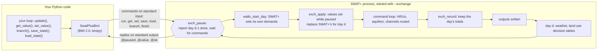
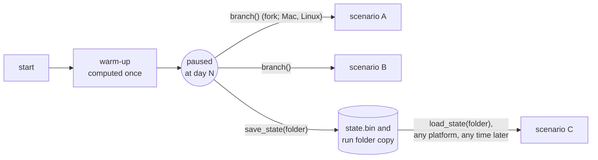

# swatplus-bmi

[](https://pypi.org/project/swatplus-bmi/)
[](https://doi.org/10.5281/zenodo.23963201)
[](https://github.com/northlinehydrology/swatplus-bmi/actions/workflows/test.yml)

Run [SWAT+](https://github.com/swat-model/swatplus) one day at a time under outside control,
through the Basic Model Interface ([BMI 2.0](https://bmi.readthedocs.io), CSDMS).

A small patch adds an exchange mode to SWAT+, off by default. In exchange mode SWAT+ pauses
before each day. While it's paused, a caller reads state (channel flow, aquifer storage, depth
to water, recharge) and sets fluxes for the next day (a point source's flow, a water user's
demand). A Python BMI wrapper drives it. Stepped this way, **SWAT+'s output is byte-for-byte
identical to an unpatched run, every output file, start to finish.** A paused run can also be
saved and loaded, or branched in memory, so a warm-up is run once and every scenario starts
from the same state.

**Status:** working for SWAT+ 62.0.1; first release 0.1.0 ([PyPI](https://pypi.org/project/swatplus-bmi/), [Zenodo](https://doi.org/10.5281/zenodo.23963201)). Tested on the two example projects that
ship with SWAT+ (below). See [COMPATIBILITY.md](COMPATIBILITY.md) and the design note,
[docs/design.md](docs/design.md).

## Why

SWAT+ normally runs from its first day to its last without stopping, so everything it will do
is fixed by its input files before it starts. Many water questions have something outside the
model reacting to what the model does:

- a utility that cuts a withdrawal when the river is low;
- a pass-by flow that must be kept;
- a well field that stops pumping at a drawdown limit;
- another model (groundwater, a water user, a reservoir operator) that answers back.

These need same-day feedback: run a day, look, decide, run the next day. Without it, the
choice is between iterating whole runs, which doesn't converge in general and multiplies run
time, and driving the rule with observed flows, which don't exist in a scenario. BMI is the
interface that coupling frameworks (CSDMS tools, NOAA's NextGen, eWaterCycle) expect. As far as
we know, no BMI for SWAT+ existed before this one.

## How it works



- **SWAT+'s side.** The patch adds seven calls to four SWAT+ files (`time_control.f90`,
  `main.f90.in`, `command.f90`, `sd_channel_control3.f90`). Each returns at once unless SWAT+ was started with
  `--exchange`. With the mode on, SWAT+ stops before each day's water allocation and routing,
  answers commands, and goes on when told to.
- **The pause point.** Values read at a pause are those at the end of the previous day. Values
  set apply to the coming day only, put in place after SWAT+ sets its own demands for the day,
  so they aren't overwritten.
- **The connection.** The two sides talk in text lines over SWAT+'s standard input and output:
  nothing linked, no sockets, nothing platform-specific for stepping. Any language that can
  write and read lines could drive SWAT+ the same way.
- **Python's side.** `SwatPlusBmi` is a BMI 2.0 model: `initialize`, `update`, `update_until`,
  `get_value`, `set_value`, grids and time functions. Each SWAT+ object type (channels,
  aquifers, point sources, water users) is a BMI grid of points.

Snapshots work two ways:



Every scenario is bit-for-bit identical to the same scenario run from the start.

## What it shows

From the example notebook ([examples/tour.py](examples/tour.py)). The project is `Osu_1hru`, a
10 ha example that ships with SWAT+, so the flows are small.


*Values read through BMI after each day agree with SWAT+'s own daily output to the four digits
SWAT+ prints. The tests check more: every output file, byte for byte, against an unpatched run.*


*A water user takes up to half the median flow. A steady user keeps taking through a dry spell.
A curtailed user checks yesterday's flow before each day and takes nothing if it was below the
30th-percentile flow. The rule is three lines of Python.*


*Each point is a full 14-year run with the curtailment threshold at a different flow
percentile: water delivered against the stream's 7-day low flow, and against days below the
10th-percentile flow. A model run to the end can't draw this curve, because the rule depends on
flows the model hasn't computed yet when it starts.*


*Three scenarios after a ten-year warm-up: branched or loaded from one warm-up, SWAT+ computes
48% fewer days. With 100 scenarios it's about 70% fewer. Each scenario is identical to running
it from the start.*

## Install

Needs Python 3.11 or later, git, make and gfortran (or Intel ifx). CMake comes with the package.

```bash
pip install swatplus-bmi          # or: uv add swatplus-bmi
swatplus-bmi build                # fetch SWAT+ 62.0.1, patch it, build it (a few minutes)
```

`swatplus-bmi build` puts the SWAT+ executable in a folder of your own: `SWATPLUS_BMI_HOME` if
set, otherwise `~/Library/Application Support/swatplus-bmi` on macOS and
`~/.local/share/swatplus-bmi` on Linux. The wrapper finds it there. `swatplus-bmi where` prints
its path. Steps:

1. Fetch the SWAT+ release.
2. Copy in the exchange module and apply the patch.
3. Generate the state serializer from SWAT+'s own module declarations.
4. Build with CMake.

On macOS, gfortran comes with Homebrew's `gcc`; on Debian and Ubuntu, `apt install gfortran`.

### From a source checkout

For development and the tests, with [uv](https://docs.astral.sh/uv/):

```bash
git clone https://github.com/northlinehydrology/swatplus-bmi && cd swatplus-bmi
uv sync
uv run ./build.sh --stock --nosave     # into bin/; the tests need all three builds
uv run pytest                          # the main suite (about two minutes on one core)
uv run pytest -m full                  # also Ames_sub1, 46 years (about 15 minutes)
uv run --group examples marimo edit examples/tour.py   # the notebook
```

`--stock` builds the unpatched release, which the tests compare against. `--nosave` builds a
variant used to check which saved locals carry state (see [Saving state](#saving-state)). The
wrapper finds the executable in `bin/` in a source checkout, in `$SWATPLUS_EXCHANGE`, in the
folder `swatplus-bmi build` writes to, or wherever the config file says.

## Using it

A SWAT+ project folder (the one with `file.cio`) is the config:

```python
import numpy as np
from swatplus_bmi import SwatPlusBmi

m = SwatPlusBmi()
m.initialize("path/to/TxtInOut")       # SWAT+ starts, paused before day 1
print(m.get_time_units())               # days since 2010-01-01 00:00:00
print(m.get_output_var_names())

q = np.empty(m.get_grid_size(m.get_var_grid("channel_water__volume_outflow_rate")),
             dtype=np.float32)
while m.get_current_time() < m.get_end_time():
    m.update()                          # one day
    m.get_value("channel_water__volume_outflow_rate", q)   # m3/s, one per channel
m.finalize()                            # SWAT+ completes its output files
```

Or a TOML file, to run a copy of the project so the original stays clean:

```toml
project = "path/to/TxtInOut"
run_dir = "runs/scenario-a"            # copied from project, then run there
executable = "bin/swatplus-62.0.1-exchange"   # optional
```

### Same-day feedback

Cut a water user's demand to zero the day after a day whose flow was below a threshold:

```python
DMD = "place_of_use_water__volume_demand_rate"     # m3/s
QOUT = "channel_water__volume_outflow_rate"

i = m.get_object_index(QOUT, "cha01")
q = np.empty(m.get_grid_size(m.get_var_grid(QOUT)), np.float32)
while m.get_current_time() < m.get_end_time():
    m.get_value(QOUT, q)                                # yesterday's flow
    if q[i] < 0.0012:
        m.set_value(DMD, np.array([0.0], np.float32))   # for the next day only
    m.update()
```

### Warm up once, then scenarios

```python
base = SwatPlusBmi()
base.initialize("runs/warmup.toml")
base.update_until(3 * 365)                  # the warm-up

a = base.branch("runs/scenario-a")          # Mac and Linux: a copy of the paused process
base.save_state("states/warm")              # any platform: a folder with the state

n = SwatPlusBmi()
n.initialize("runs/scenario-c.toml")
n.load_state("states/warm")                 # carries on from day 1095, as the saved run would
state = n.get_state()                       # the same as bytes; set_state(state) restores it
```

### Turning on SWAT+'s own output

```python
from swatplus_bmi.project import set_print
set_print("path/to/TxtInOut", ["channel_sd", "aquifer"], intervals=["daily"], skip_years=0)
```

### Coupling a groundwater model

Each day, read `channel_water__depth` for the river stage. Then set
`channel_water__groundwater_volume_exchange_rate` for the next day:
- a gain (positive) joins the channel's inflow, through the same transfer SWAT+ uses for water
  allocation returns;
- a loss (negative) is taken from the day's outflow after routing, no more than is there, and
  counted in the channel's seepage, so SWAT+'s printed channel balance still closes.

Read the same variable after the day for what was actually exchanged. Pass that back to the
groundwater model, so the two balances agree.

### Objects and grids

Each SWAT+ object type is a BMI grid of type `points`: one point per object, longitude as x and
latitude as y (water users have no location: NaN). `get_grid_object_names(grid)` gives the
SWAT+ object names, and `get_object_index(var, name)` gives an object's index. Grids with no
objects in a project are left out.

## Variables

| Variable | Objects | Set? | Units | SWAT+ source |
|---|---|---|---|---|
| `channel_water__volume_outflow_rate` | channels | no | m3 s-1 | `flo_out` in `channel_sd_day.txt` |
| `channel_water__volume_inflow_rate` (net inflow) | channels | no | m3 s-1 | `flo_in` |
| `channel_water__volume` | channels | no | m3 | `flo_stor` |
| `channel_water__depth` | channels | no | m | depth on SWAT+'s rating curve at the day's mean outflow |
| `channel_water__groundwater_volume_exchange_rate` | channels | yes | m3 s-1 | groundwater exchange, positive into the channel; a loss is counted in `seep` |
| `aquifer_water__volume` | aquifers | no | m3 | `stor` in `aquifer_day.txt` (mm × area) |
| `soil_water_table_surface__depth` (depth to water) | aquifers | no | m | `dep_wt` |
| `aquifer_water__volume_outflow_rate` | aquifers | no | m3 s-1 | `flo` (return flow) |
| `soil_water_table__recharge_rate` | aquifers | no | m s-1 | `rchrg` |
| `point_source_water__volume_flow_rate` | daily recall objects | yes | m3 s-1 | the recall file's flow |
| `place_of_use_water__volume_demand_rate` | water allocation places of use | yes | m3 s-1 | the day's demand |
| `place_of_use_water__volume_withdrawal_rate` | water allocation places of use | no | m3 s-1 | what was actually taken |

Names follow [CSDMS Standard Names](https://csdms.colorado.edu/wiki/CSDMS_Standard_Names). The
channel volume and flow names and the recharge name are on the CSDMS list. The others are new,
built the same way. All values are 4-byte reals, as SWAT+ keeps them. Every variable is checked
against SWAT+'s own daily output in the tests.

## Saving state

BMI 2.0 has no state functions. The wrapper adds `save_state`, `load_state`, `get_state` and
`set_state`, after the CSDMS proposal for `get_state`/`set_state`
([bmi PR #112](https://github.com/csdms/bmi/pull/112)), and `branch`.

- **The serializer is generated, not written by hand.** `tools/gen_serializer.py` reads the
  release's module declarations and writes Fortran that saves and loads every module variable
  (65 modules, 2,048 variables, 523 derived types in 62.0.1). It's rerun on every build, and a
  state is refused by any build other than the one that wrote it.
- **Saved locals.** Fortran locals with an initializer keep their values between calls, and
  SWAT+ has about 5,400 of them. A test build that resets them all on every call
  (`build.sh --nosave`) shows which ones carry state. In 62.0.1 only one does on the test
  projects, a "header written" flag. It's listed in `patches/62.0.1/carried-locals.toml` and
  moved into a module at build time so it's saved too.
- **Loading.** A new process can't jump into the middle of SWAT+'s daily loop. So `load` runs it
  forward to the saved day without computing anything, reads the saved state over its own, and
  puts back the saved output files.
- **Branching** copies the paused process with `fork`, which needs none of this.

## Strengths

- **Exact.** Stepping, reading, branching and saving don't change a byte of SWAT+'s output. The
  suite checks every output file against unpatched SWAT+, including 46 years of Ames_sub1.
- **Small and off by default.** Seven calls in four SWAT+ files, one Fortran module, and a C file
  of four functions for `fork`. With the mode off, SWAT+ behaves exactly as it does without the
  patch. It's meant to be proposed to the SWAT+ team (`docs/upstream-issue.md`).
- **No linking, any platform for stepping.** Text over standard input and output. The Python
  wrapper is a separate program, which keeps the licenses apart.
- **Standard interface.** BMI 2.0 with CSDMS names and time in days since the start date, as
  eWaterCycle expects.
- **Warm-ups shared.** Branching is instant. Saved states work across processes, platforms and
  sessions.
- **Checked against SWAT+ itself.** Every variable is compared with SWAT+'s own output. The
  water balances in the tests close to SWAT+'s printed precision, except where SWAT+ itself
  doesn't balance; those cases are tested too (see Gotchas).

## Weaknesses and limits

- **Daily steps only.** SWAT+'s sub-daily options aren't exposed.
- **Only fluxes can be set:** point source flow and water allocation demand, for the next day.
  Not storage, land use, soils or parameters; those are scenario inputs.
- **A handful of variables so far.** Adding one is a few lines (see `fortran/`), but each needs a
  test against SWAT+'s output.
- **One process per model, one message per day per value.** On a tiny project the messages cost
  more than SWAT+'s computing. On a real project computing dominates.
- **Branching needs fork:** Mac and Linux. Saving and loading work everywhere, but the Windows
  build hasn't been tried.
- **Saved states depend on the code a project runs.** The list of saved locals that carry state
  is complete for the code the test projects run: about half of SWAT+'s procedures. That
  excludes gwflow, salts and other constituents, reservoirs, pesticides and calibration. A
  project that uses those should be checked with `build.sh --nosave` and `pytest -m full` first.
  Branching isn't affected.
- **Loading takes a moment.** A loaded process runs forward through the saved days without
  computing them. Branching is instant.
- **NextGen can use SWAT+ only as one model for the whole domain**, not split by catchment,
  because SWAT+ routes its own channel network.
- **Soft and hard calibration runs are refused** in exchange mode; they run SWAT+'s daily loop
  more than once.
- **One SWAT+ version at a time:** 62.0.1 (COMPATIBILITY.md). SWAT+ main is tested nightly.

## Gotchas

- **A set value lasts one day.** `set_value` before `update()` applies to that day only, then
  SWAT+ goes back to its own inputs. Set it every day for a lasting change.
- **Values read at a pause are yesterday's.** SWAT+ has also read the coming day's weather, but
  hasn't routed it. That's what a same-day rule needs, but it matters when lining up times with
  observations.
- **SWAT+'s own limits still apply.** A demand set above the water allocation's `rate_max` is
  capped at it, and a channel withdrawal can't take more than the channel routes that day.
- **Use water allocation for withdrawals, not a negative point source.** SWAT+ 62.0.1 doesn't
  limit a recall diversion to the water in the channel. When it's larger than the other inflow,
  SWAT+ records it in full and takes none of the excess: 4.1% of the withdrawal in our test, all
  of it on low-flow days. The wrapper warns, and `channel_water__volume_inflow_rate` goes
  negative on those days. (Draft report: `docs/upstream-issue-recall-diversion.md`.)
- **Aquifer withdrawals in SWAT+ 62.0.1 deliver less than they remove.** The aquifer loses the
  demand, but the user is credited with demand × (1 − demand/storage). It's a bug in
  `wallo_withdraw.f90`; a test documents it and will fail once SWAT+ fixes it. (Draft report:
  `docs/upstream-issue-aquifer-withdrawal.md`.)
- **`recall_day.txt` labels flows m³/s, but they're m³/day.** The wrapper converts correctly.
- **`get_value_ptr` isn't available.** The values live in the SWAT+ process; use `get_value`.
- **`print.prt` rows are read by position unless labels are on.** The second value on the line under
  `csvout` is SWAT+'s `use_obj_labels` switch (some projects label that column `dbout`). With it at
  `n`, as in SWAT+'s examples, SWAT+ reads the object rows in its own order and ignores their names,
  so switching on the row named `aquifer` by hand can switch on something else. Use
  `swatplus_bmi.project.set_print(project, ["aquifer"], intervals=["daily"])`, which turns labels on
  and edits rows by name.
- **A run stopped early keeps its daily output up to that day.** `finalize()` before the last day
  stops SWAT+; the daily files are complete to the day it reached, but yearly and average-annual
  summaries and `success.fin` aren't written.
- **Outputs go to the run folder.** Use `run_dir` in a TOML config to keep the project folder
  clean. A branch or a loaded run writes to its own folder.
- **The scenario's first day.** A rule that reacts to yesterday's flow should read it before its
  first `update()`, also after `branch` or `load_state`. Otherwise its first decision differs
  from the unbroken run's (the notebook shows how).

## The protocol

Start SWAT+ with `--exchange` in its project folder. It sends a catalog (`@grid`, `@obj`, `@var`
lines, then `@ready`), then `@paused <days done> <year> <day of year>`, and waits:

```
run [n]                    run n days (default 1)          -> @paused ... or @ended <days>
get <variable>             one value per object             -> @value <n> <v1> ... <vn>
set <variable> <i> <v>     object i (1-based), next day     -> @ok
save "<file>"              the state at this pause          -> @ok
load "<file>"              right after startup              -> @restore ... then @paused
branch "<new>" "<old>" "<in>" "<out>"   fork (Mac, Linux)   -> @branched <pid>
flush | ping                                                -> @ok
finish                     run to the end, complete outputs
stop                       stop now                         -> @bye
```

Errors come back as `@error <message>` and SWAT+ keeps waiting. Details:
[docs/design.md](docs/design.md).

## Tests

`uv run pytest` builds nothing; run `build.sh --stock --nosave` first. The tests use the two
example projects that ship with SWAT+: `Osu_1hru` (one HRU, a channel and an aquifer,
2010-2023) in several variants (all output printed daily, a daily point source, a water user on
the channel, a well on the aquifer), and `Ames_sub1` (12 HRUs, 1975-2020) under `-m full`. The
full-length Ames runs leave out Ames's daily per-layer soil carbon diagnostics (`hru_cb` and
`hru_cb_vars` set to `l`), about 8.5 GB a run; their monthly and yearly output, and the
five-year run that prints everything daily, are still compared. Each test deletes its run
folders once it passes (set `SWATPLUS_BMI_KEEP_RUNS=1` to keep them).

| What | How it's checked |
|---|---|
| Exchange mode off changes nothing | every output file against unpatched SWAT+, byte for byte |
| Stepping changes nothing | the same, stepped one day at a time and in chunks, 14 and 46 years |
| Values read are SWAT+'s | every variable, every day, against SWAT+'s daily output files |
| Set values take effect exactly | a set withdrawal leaves the channel short by exactly that water; balances close |
| Same-day rules | a curtailment rule acts on the right days |
| Branching | at days 0, 365, 1000 and the last; a branch of a branch; scenarios against unbroken runs |
| Saving and loading | the same, across processes; values read back exactly; another build's state refused |
| Saved locals | a build that resets them on every call matches stock, except the listed ones |

CI (GitHub Actions) runs the suite on Ubuntu and macOS on every push. Each night it also runs the full-length tests and builds SWAT+
main with the current patch, as an early warning for the next SWAT+ release.

## AI use

swatplus-bmi was designed and directed by Andrew Sommerlot and built with an AI coding
assistant (Claude, by Anthropic), which wrote most of the code, tests and documentation under
his direction and review. Whether it's right doesn't rest on the assistant. It rests on the
tests against unmodified SWAT+: every output file compared byte for byte, every variable
compared with SWAT+'s own output, and water balances checked. Anyone can run them.

## Citing, contributing, license

- **Citing:** cite the archived software, [doi:10.5281/zenodo.23963201](https://doi.org/10.5281/zenodo.23963201)
  (all versions; each release also has its own DOI). Details in [CITATION.cff](CITATION.cff).
- **Contributing:** see [CONTRIBUTING.md](CONTRIBUTING.md). Issues and pull requests are welcome,
  especially SWAT+ projects that exercise code the tests don't yet cover.
- **License:** the exchange mode (`fortran/`, `patches/`) and any SWAT+ built with it are under
  the GNU LGPL 2.1, the license of SWAT+. The Python wrapper is a separate program that runs
  SWAT+ as its own process. It, and everything else here, is under the BSD 3-Clause license. See
  [LICENSE](LICENSE).

SWAT+ is developed by USDA-ARS and Texas A&M AgriLife Research. This project is independent of
them.
