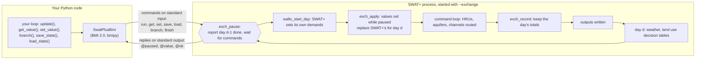
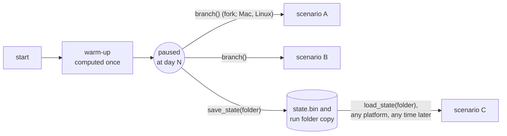
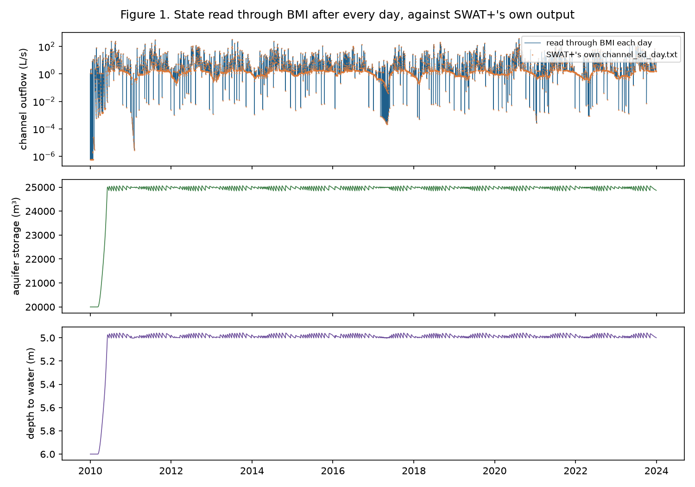
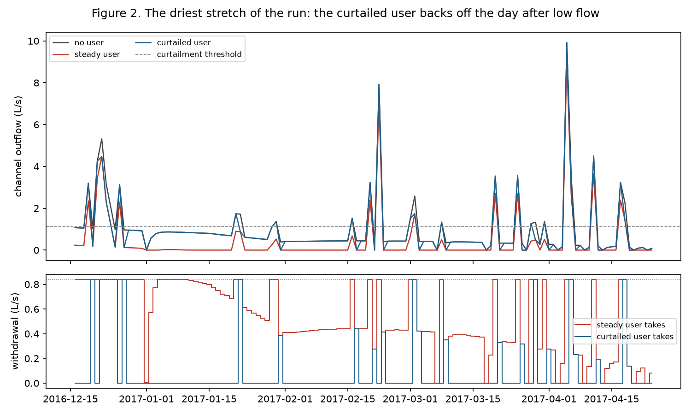
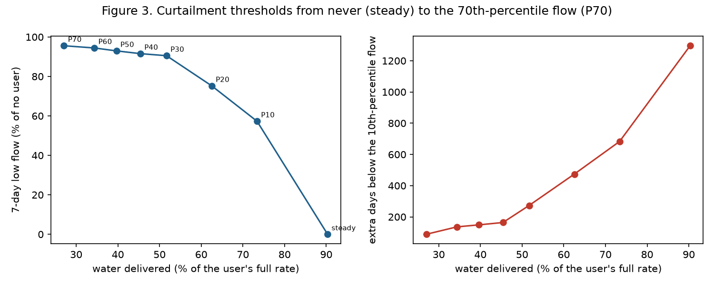
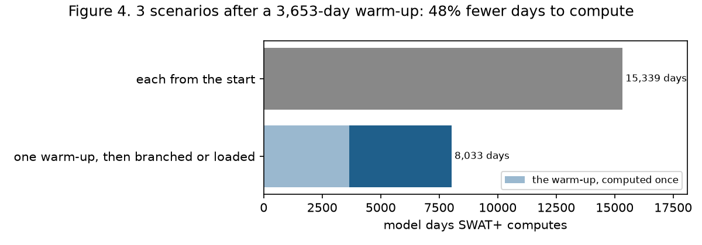

# swatplus-bmi

[](https://pypi.org/project/swatplus-bmi/)
[](https://doi.org/10.5281/zenodo.23963201)
[](https://github.com/northlinehydrology/swatplus-bmi/actions/workflows/test.yml)

Run [SWAT+](https://github.com/swat-model/swatplus) one day at a time under outside control,
through the Basic Model Interface ([BMI 2.0](https://bmi.readthedocs.io), CSDMS).

A small patch adds an exchange mode to SWAT+, off by default. In exchange mode SWAT+ pauses
before each day. While it's paused, a caller reads state (channel flow, aquifer storage, depth
to water, recharge, each HRU's percolation, evapotranspiration and soil water, snowpack, and
the salt, nitrate and phosphorus carried with the water) and
sets values for the next day: fluxes (a point source's flow and load, a water user's demand, a
channel's exchange with groundwater and the mass it carries) and, as a first state, soil layer
temperature. Weather is set ahead, into the gages' records: a whole series at the start, or any
day SWAT+ hasn't read yet. A Python BMI wrapper drives it. **With nothing set, SWAT+'s output is byte-for-byte
identical to an unpatched run, every output file, start to finish, however the run is stepped,
read, branched or saved; a value set changes the run only through that input; and anything
SWAT+ wouldn't use as given is refused rather than dropped.** The tests check each of those
against unpatched SWAT+ on the projects listed in [COMPATIBILITY.md](COMPATIBILITY.md). A
paused run can also be saved and loaded, or branched in memory, so a warm-up is run once and
every scenario starts from the same state.

**Status:** working for SWAT+ 62.0.1; release 0.8.0 ([PyPI](https://pypi.org/project/swatplus-bmi/), [Zenodo](https://doi.org/10.5281/zenodo.23963201)). Tested on the two example projects that
ship with SWAT+ (below) and a 2,371-HRU study build. See [COMPATIBILITY.md](COMPATIBILITY.md) and the design note,
[docs/design.md](docs/design.md).

## Why

SWAT+ normally runs from its first day to its last without stopping, so everything it will do
is fixed by its input files before it starts. Many water questions have something outside the
model reacting to what the model does:

- a utility that cuts a withdrawal when the river is low;
- a pass-by flow that must be kept;
- a well field that stops pumping at a drawdown limit;
- another model (groundwater, a water user, a reservoir operator) that answers back.

These need same-day feedback: run a day, look, decide, run the next day. Without it, the
choice is between iterating whole runs, which doesn't converge in general and multiplies run
time, and driving the rule with observed flows, which don't exist in a scenario. BMI is the
interface that coupling frameworks (CSDMS tools, NOAA's NextGen, eWaterCycle) expect. As far as
we know, no BMI for SWAT+ existed before this one.

## How it works



- **SWAT+'s side.** The patch adds ten calls to five SWAT+ files (`time_control.f90`,
  `main.f90.in`, `command.f90`, `sd_channel_control3.f90`, `hru_control.f90`). Each returns at
  once unless SWAT+ was started with `--exchange`. With the mode on, SWAT+ stops before each day's water allocation and routing,
  answers commands, and goes on when told to.
- **The pause point.** Values read at a pause are those at the end of the previous day. Values
  set apply to the coming day only. A flux is put in place after SWAT+ sets its own demands for
  the day, so it isn't overwritten; a state, right after SWAT+ computes it that day.
- **The connection.** The two sides talk in text lines over SWAT+'s standard input and output:
  nothing linked, no sockets, nothing platform-specific for stepping. Any language that can
  write and read lines could drive SWAT+ the same way.
- **Python's side.** `SwatPlusBmi` is a BMI 2.0 model: `initialize`, `update`, `update_until`,
  `get_value`, `set_value`, grids and time functions. Each SWAT+ object type (channels,
  aquifers, point sources, water users) is a BMI grid of points.

Snapshots work two ways:



Every scenario is bit-for-bit identical to the same scenario run from the start.

## What it shows

From the example notebook ([examples/tour.py](examples/tour.py)). The project is `Osu_1hru`, a
10 ha example that ships with SWAT+, so the flows are small.



*Values read through BMI after each day agree with SWAT+'s own daily output to the four digits
SWAT+ prints. The tests check more: every output file, byte for byte, against an unpatched run.*



*A water user takes up to half the median flow. A steady user keeps taking through a dry spell.
A curtailed user checks yesterday's flow before each day and takes nothing if it was below the
30th-percentile flow. The rule is three lines of Python.*



*Each point is a full 14-year run with the curtailment threshold at a different flow
percentile: water delivered against the stream's 7-day low flow, and against days below the
10th-percentile flow. A model run to the end can't draw this curve, because the rule depends on
flows the model hasn't computed yet when it starts.*



*Three scenarios after a ten-year warm-up: branched or loaded from one warm-up, SWAT+ computes
48% fewer days. With 100 scenarios it's about 70% fewer. Each scenario is identical to running
it from the start.*

## Install

Needs Python 3.11 or later, git, make and gfortran (or Intel ifx). CMake comes with the package.

```bash
pip install swatplus-bmi          # or: uv add swatplus-bmi
swatplus-bmi build                # fetch SWAT+ 62.0.1, patch it, build it (a few minutes)
```

`swatplus-bmi build` puts the SWAT+ executable in a folder of your own: `SWATPLUS_BMI_HOME` if
set, otherwise `~/Library/Application Support/swatplus-bmi` on macOS and
`~/.local/share/swatplus-bmi` on Linux. The wrapper finds it there. `swatplus-bmi where` prints
its path. Steps:

1. Fetch the SWAT+ release.
2. Copy in the exchange module and apply the patch.
3. Generate the state serializer from SWAT+'s own module declarations.
4. Build with CMake.

On macOS, gfortran comes with Homebrew's `gcc`; on Debian and Ubuntu, `apt install gfortran`.

### From a source checkout

For development and the tests, with [uv](https://docs.astral.sh/uv/):

```bash
git clone https://github.com/northlinehydrology/swatplus-bmi && cd swatplus-bmi
uv sync
uv run ./build.sh --stock --nosave --check   # into bin/; the tests need all four builds
uv run pytest                          # the main suite (about two minutes on one core)
uv run pytest -m full                  # also Ames_sub1, 46 years (about 15 minutes)
uv run --group examples marimo edit examples/tour.py   # the notebook
```

`--stock` builds the unpatched release, which the tests compare against. `--nosave` builds a
variant used to check which saved locals carry state (see [Saving state](#saving-state)).
`--check` builds the exchange mode with array bounds checked, for the tests that set values.
After changing anything in `fortran/`, `patches/` or `build.sh`, build again: the wrapper refuses
an executable built from other sources. The
wrapper finds the executable in `bin/` in a source checkout, in `$SWATPLUS_EXCHANGE`, in the
folder `swatplus-bmi build` writes to, or wherever the config file says.

## Using it

A SWAT+ project folder (the one with `file.cio`) is the config:

```python
import numpy as np
from swatplus_bmi import SwatPlusBmi

m = SwatPlusBmi()
m.initialize("path/to/TxtInOut")       # SWAT+ starts, paused before day 1
print(m.get_time_units())               # days since 2010-01-01 00:00:00
print(m.get_output_var_names())

q = np.empty(m.get_grid_size(m.get_var_grid("channel_water__volume_outflow_rate")))
while m.get_current_time() < m.get_end_time():
    m.update()                          # one day
    m.get_value("channel_water__volume_outflow_rate", q)   # m3/s, one per channel
m.finalize()                            # SWAT+ completes its output files
```

Or a TOML file, to run a copy of the project so the original stays clean:

```toml
project = "path/to/TxtInOut"
run_dir = "runs/scenario-a"            # copied from project, then run there
executable = "bin/swatplus-62.0.1-exchange"   # optional
```

### Same-day feedback

Cut a water user's demand to zero the day after a day whose flow was below a threshold:

```python
DMD = "place_of_use_water__volume_demand_rate"     # m3/s
QOUT = "channel_water__volume_outflow_rate"

i = m.get_object_index(QOUT, "cha01")
q = np.empty(m.get_grid_size(m.get_var_grid(QOUT)))
while m.get_current_time() < m.get_end_time():
    m.get_value(QOUT, q)                                # yesterday's flow
    if q[i] < 0.0012:
        m.set_value(DMD, np.array([0.0]))               # for the next day only
    m.update()
```

### Warm up once, then scenarios

```python
base = SwatPlusBmi()
base.initialize("runs/warmup.toml")
base.update_until(3 * 365)                  # the warm-up

a = base.branch("runs/scenario-a")          # Mac and Linux: a copy of the paused process
base.save_state("states/warm")              # any platform: a folder with the state

n = SwatPlusBmi()
n.initialize("runs/scenario-c.toml")
n.load_state("states/warm")                 # carries on from day 1095, as the saved run would
state = n.get_state()                       # the same as bytes; set_state(state) restores it
```

### Turning on SWAT+'s own output

```python
from swatplus_bmi.project import set_print
set_print("path/to/TxtInOut", ["channel_sd", "aquifer"], intervals=["daily"], skip_years=0)
```

### Coupling a groundwater model

Each day, read `channel_water__depth` for the river stage. Then set
`channel_water__groundwater_volume_exchange_rate` for the next day:
- a gain (positive) joins the channel's inflow, through the same transfer SWAT+ uses for water
  allocation returns;
- a loss (negative) is taken from the day's outflow after routing, no more than is there, and
  counted in the channel's seepage, so SWAT+'s printed channel balance still closes.

Read the same variable after the day for what was actually exchanged. Pass that back to the
groundwater model, so the two balances agree.

Water goes both ways between the soil and the groundwater model, HRU by HRU:
- down: `soil_water__percolation_rate` is the water leaving the bottom of each HRU's soil
  profile, the groundwater model's recharge under that HRU;
- up: where the groundwater model's water table rises into an HRU's soil profile, set
  `soil_layer_water__groundwater_inflow_rate` for the next day, layer by layer. The water goes
  into those layers where SWAT+'s own groundwater model, gwflow, puts its own (`gwflow_soil`, at
  the start of the day's percolation), and SWAT+ counts it the same way, as `gwsoilq` in
  `hru_wb`. SWAT+ then moves it as it moves any soil water: up to the plants, out as lateral
  flow, back down as percolation, or to the surface where the profile can't hold it. Take the
  same water out of the groundwater model.

How much goes into which layer is the coupling's to decide. gwflow fills each layer below the
water table in proportion to how much of it lies below, with a cell's specific yield times the
height of the water table above the bottom of the profile as the volume. A set applies to the
next day only; reading it after the day gives what went in, and
`soil_water__groundwater_inflow_rate` gives each HRU's total. It can't be negative (water
leaving the soil is percolation), and is refused in a project that runs gwflow, which would put
in its own as well. To size and place it, each layer's bottom, water, saturation and field
capacity are on the same grid, as SWAT+ keeps them (the water depths above the wilting point):
the room left in a layer is `soil_layer_water__saturation_depth` less
`soil_layer_water__depth`.

Nitrate (as N) and labile phosphorus come up with the water as gwflow brings them: with the
water set for a layer, set `soil_layer_water_no3__groundwater_inflow_mass_rate` and
`soil_layer_water_solp__groundwater_inflow_mass_rate` (kg s-1 into the layer). They go into the
layer's nitrate and labile P where gwflow adds its own (at the start of `nut_nlch` and
`nut_solp`), counted as `gwsoiln` and `gwsoilp` in `hru_nb`. A mass without water set for its
layer is refused.

Chemistry goes the same way. For each salt ion SWAT+'s salt module simulates, and for nitrate
(`no3`, as N) and soluble phosphorus (`solp`, as P):
- read `aquifer_water_<ion>__recharge_mass_rate` for the mass reaching the water table, to pass
  to a groundwater transport model;
- with a gain, set `channel_water_<ion>__groundwater_mass_exchange_rate` for the mass the
  groundwater brings (set the gain first). Nitrate and phosphorus go with the water through the
  transfer; salt joins the channel's incoming load, as an aquifer's does;
- a loss takes the same share of the outflow's salt, nitrate and phosphorus as of its water,
  counted as seepage. `channel_water_<ion>__mass_concentration` is the day's outflow
  concentration, and the exchange variable read after the day is the mass that went either way.

### Weather

Each weather gage SWAT+ reads a file for (precipitation, temperature, solar radiation, humidity,
wind) is a point on its own grid (`pcp`, `tmp`, `slr`, `hmd`, `wnd`), named by its file. A
value set goes into the gage's record, where its file would hold it, so the run is the one a
file with that value would give: SWAT+ builds the mean temperature, PET, the generator's wet and
dry days, heat units and the stream temperature's air lag from it, as it always does.

SWAT+ reads a day's weather before the pause that comes before that day, and precipitation a day
earlier still (its decision tables look at the next day's rain). So a weather record can be set
for any day from `first_weather_day(name)` on: the day after the coming one, or the day after
that for precipitation. A whole series goes in with `set_weather`, and any day not yet read can
be set again:

```python
import datetime as dt
P = "atmosphere_water__precipitation_leq-volume_flux"     # m s-1
m.initialize("TxtInOut")
m.set_weather(P, m.first_weather_day(P), era5_mm_per_day / 86_400_000)   # (days, gages)
m.update_until(365)
b = m.branch("TxtInOut-dry")                              # one warm-up, two futures
b.set_weather(P, b.first_weather_day(P), dry_mm_per_day / 86_400_000)
```

`set_value` writes the first day not yet read, so a weather model can feed SWAT+ a day or two
ahead. SWAT+ reads the first day of temperature, solar radiation, humidity and wind, and the
first two of precipitation, before it first pauses, so those come from the files; to have them
from the same series, write them into the run's files first with
`swatplus_bmi.project.write_weather(run_dir, file, start, values)` (in the file's units), then
set the rest. A run done that way is byte for byte the run whose files hold the whole series. A
record can only be set inside the period the gage's file
covers (SWAT+ generates the days outside it), and only for a gage with daily records. Reading a
weather variable gives each gage's record for the day just done (NaN where it has none). Gages
are per file, not per HRU: a set changes a gage's values, not which gage a station uses, so
finer weather needs a gage for each cell in the project's files. SWAT+ 62.0.1's monthly
climate-change adjustments are never read from any input, so they stay zero.

### Parameters

Parameters change once, at initialize, through SWAT+'s own `calibration.cal`: SWAT+ reads it
before its first day and changes each named parameter for the objects listed. A TOML config
lists the changes (it needs `run_dir`, so the project's own file isn't touched):

```toml
project = "path/to/TxtInOut"
run_dir = "runs/scenario-a"

[[parameter]]
name = "cn2"
value = -10                  # percent
change = "pctchg"            # absval, abschg, pctchg (percent) or relchg (a fraction)
objects = [1, 2, 3]          # SWAT+'s object numbers; all when left out
conditions = {landuse = "cosy_lum"}   # or hsg (soil group) or texture; HRU parameters only

[[parameter]]
name = "awc"
value = 0.15
change = "absval"
layers = [1, 2]              # soil parameters: first and last layer, 0 for all
```

The rows go after the project's own, in order, and SWAT+ makes them; the wrapper writes the file
and nothing else, so a run is the one stock SWAT+ makes from the same `calibration.cal` (the
tests check it byte for byte). `swatplus_bmi.calibration.Change` and `write_changes` do the same
from Python.

Not every change SWAT+ reads is one it makes. `tools/audit_parameters.py` tried each parameter
in the SWAT+ editor's `cal_parms.cal` alone on the test projects, from both the 2.2.0 list (226
rows, the one in SWAT+'s example projects) and the 3.1.0 list (261 rows, the current one,
unchanged through 4.0.0, with 48 names the older one lacks and 13 it dropped), and read SWAT+'s
source where a change moved nothing ([docs/parameters-62.0.1.md](docs/parameters-62.0.1.md)).
Of 274 rows in either list, in 62.0.1:

- **91 made:** they moved the output of a test project with their objects.
- **22 skipped:** SWAT+ reads the name and has no code for it. Among them editor 3.1's HRU
  `lai_pot`, `harv_idx` and `phu_mat`, and the names editor 3.0 gave `chseq` and a new one
  (`flood_sedfrac`, `part_size`). Refused.
- **50 refused** for what the code does:
  - 33 are used only while SWAT+ starts up, before it applies `calibration.cal`, so the change
    reaches nothing: `chn`, `fps`, `fpn`, `chk` and `chss` (the rating curves and storage
    coefficients), `usle_p`, `ovn`, `slope_len`, the aquifer's starting `dep_wt_init`,
    `flo_init_mm` and `cbn_init`, and `nperco`, `nperco_lchtile`, `pperco`, `phoskd`, `psp`
    and `cmn`, which SWAT+ copies into each HRU when it starts.
  - 4 are overwritten: a soil's `lab_p`, `cbn`, `hum_c_n` and `hum_c_p` change the soil's
    pools, which SWAT+ sets again from its inputs right after (`soil_nutcarb_init`).
  - 5 are never read (`evlai`, `rs6`, `rs7`, `rk6`, `flo_dist`).
  - Channel `d50` is set to 1.0 every day, and `tile_latk` changes the tile lag.
  - The six plant (`plt`) rows have no plant code: SWAT+ changes plants only for `phu_mat`,
    `lai_pot`, `harv_idx` and `epco`, and those by plant-database number.
- **111 not checked:** neither project has their objects (reservoirs, HRU-lte, pesticides,
  gwflow), or their process doesn't run there (tiles, cracks, lapse rates, sub-daily unit
  hydrographs, the carbon rates). Allowed, with a warning.

An `absval` outside `cal_parms.cal`'s range is refused (SWAT+ would quietly use the nearer end),
as are an unknown change type (SWAT+ would leave whatever memory held), objects that aren't in
the project, layers on a parameter that isn't a soil's, and conditions on anything but an HRU's
soil group, texture or land use (SWAT+ would read them for another object's number). A
relative change is clamped to the range by SWAT+ object by object, which the wrapper can't see
ahead. 15 names SWAT+ 62.0.1 has code for are in neither editor list (`nperco_h`, `cmn_h`,
`tile_K` and others); they aren't checked, so they're refused.

### Objects and grids

Each SWAT+ object type is a BMI grid of type `points`: one point per object, longitude as x and
latitude as y (water users have no location: NaN). `get_grid_object_names(grid)` gives the
SWAT+ object names, and `get_object_index(var, name)` gives an object's index. Grids with no
objects in a project are left out. Landscape units and the basin (for the
`lsunit_*` and `basin_*` reads below) have no location either.

## Variables

| Variable | Objects | Set? | Units | SWAT+ source |
|---|---|---|---|---|
| `channel_water__volume_outflow_rate` | channels | no | m3 s-1 | `flo_out` in `channel_sd_day.txt` |
| `channel_water__volume_inflow_rate` (net inflow) | channels | no | m3 s-1 | `flo_in` |
| `channel_water__volume` | channels | no | m3 | `flo_stor` |
| `channel_water__depth` | channels | no | m | depth on SWAT+'s rating curve at the day's mean outflow |
| `channel_water__groundwater_volume_exchange_rate` | channels | yes | m3 s-1 | groundwater exchange, positive into the channel; a loss is counted in `seep` |
| `aquifer_water__volume` | aquifers | no | m3 | `stor` in `aquifer_day.txt` (mm × area) |
| `soil_water_table_surface__depth` (depth to water) | aquifers | no | m | `dep_wt` |
| `aquifer_water__volume_outflow_rate` | aquifers | no | m3 s-1 | `flo` (return flow) |
| `soil_water_table__recharge_rate` | aquifers | no | m s-1 | `rchrg` |
| `point_source_water__volume_flow_rate` | recall objects | daily ones, inside their records | m3 s-1 | the recall file's flow |
| `place_of_use_water__volume_demand_rate` | water allocation places of use | yes | m3 s-1 | the day's demand |
| `place_of_use_water__volume_withdrawal_rate` | water allocation places of use | no | m3 s-1 | what was actually taken |
| `soil_layer__temperature` | HRU soil layers | yes (a state) | degC | each layer's temperature; layer 2 is `sol_tmp` in `hru_pw_day.txt` |
| `snowpack__liquid-equivalent_depth` | HRUs | no | m | `sno_final` in `hru_wb_day.txt` |
| `soil_water__percolation_rate` | HRUs | no | m s-1 | `perc` in `hru_wb_day.txt`: water leaving the bottom of the soil profile, recharge HRU by HRU |
| `land_surface__evapotranspiration_rate` | HRUs | no | m s-1 | `et` |
| `land_surface__potential_evapotranspiration_rate` | HRUs | no | m s-1 | `pet` |
| `soil_water__depth` | HRUs | no | m | `sw_final`: the profile's water above the wilting point |
| `soil_layer_water__groundwater_inflow_rate` | HRU soil layers | yes (the next day) | m s-1 | groundwater into the layer, where gwflow puts its own; read after the day, what went in |
| `soil_water__groundwater_inflow_rate` | HRUs | no | m s-1 | `gwsoilq` in `hru_wb_day.txt`: groundwater into the soil profile, gwflow's or set |
| `soil_layer_bottom__depth` | HRU soil layers | no | m | the layer's bottom below the surface (`d`) |
| `soil_layer__thickness` | HRU soil layers | no | m | `thick` |
| `soil_layer_water__depth` | HRU soil layers | no | m | the layer's water above the wilting point (`st`); the layers add up to `soil_water__depth` |
| `soil_layer_water__wilting_point_depth` | HRU soil layers | no | m | water held at the wilting point (`wpmm`) |
| `soil_layer_water__field_capacity_depth` | HRU soil layers | no | m | water at field capacity, above the wilting point (`fc`) |
| `soil_layer_water__saturation_depth` | HRU soil layers | no | m | water at saturation, above the wilting point (`ul`) |
| `soil_layer__saturated_hydraulic_conductivity` | HRU soil layers | no | m s-1 | `k` (mm/hr) |
| `soil_layer_water_no3__groundwater_inflow_mass_rate` | HRU soil layers | with the layer's water | kg s-1 | nitrate (N) with the groundwater, into the layer's nitrate |
| `soil_layer_water_solp__groundwater_inflow_mass_rate` | HRU soil layers | with the layer's water | kg s-1 | labile P with the groundwater, into the layer's labile P |
| `soil_water_no3__groundwater_inflow_mass_rate`, `soil_water_solp__groundwater_inflow_mass_rate` | HRUs | no | kg s-1 | `gwsoiln`, `gwsoilp` in `hru_nb_day.txt` (kg/ha) × area: gwflow's or set |
| `atmosphere_water__precipitation_leq-volume_flux` | precipitation gages | yes (records ahead) | m s-1 | the gage's `.pcp` record (mm/day) |
| `atmosphere_bottom_air__max_of_temperature` | temperature gages | yes (records ahead) | degC | the `.tmp` record's maximum |
| `atmosphere_bottom_air__min_of_temperature` | temperature gages | yes (records ahead) | degC | the `.tmp` record's minimum |
| `land_surface_radiation~incoming~shortwave__energy_flux` | solar radiation gages | yes (records ahead) | W m-2 | the `.slr` record (MJ/m2/day) |
| `atmosphere_bottom_air_water~vapor__relative_saturation` | humidity gages | yes (records ahead) | 1 | the `.hmd` record (a fraction) |
| `atmosphere_bottom_air_flow__speed` | wind gages | yes (records ahead) | m s-1 | the `.wnd` record |
| `channel_water_<sp>__mass_concentration` | channels | no | kg m-3 | the day's outflow mass over outflow volume (0 with no outflow) |
| `channel_water_<sp>__groundwater_mass_exchange_rate` | channels | with a gain | kg s-1 | mass with the groundwater exchange, positive into the channel; a loss takes the outflow's concentration |
| `aquifer_water_<sp>__recharge_mass_rate` | aquifers | no | kg s-1 | what SWAT+ takes into the aquifer with recharge (`no3_rchg` × area for nitrate) |
| `point_source_water_<sp>__mass_flow_rate` | recall objects | daily ones, inside their records | kg s-1 | the recall file's load (0 for a diversion) |

`<sp>` is each salt ion as SWAT+ reads it from `constituents.cs` (`so4`, `ca`, `mg`, `na`, `k`,
`cl`, `co3`, `hco3` in the salt module's order), then `no3` (nitrate-N) and `solp` (soluble P).
Without the salt module only `no3` and `solp` are there. A salt load needs the point source's
daily record in `salt_recall.rec`.

Names follow [CSDMS Standard Names](https://csdms.colorado.edu/wiki/CSDMS_Standard_Names). The
channel volume and flow names and the recharge name are on the CSDMS list. The others are new,
built the same way. SWAT+ keeps 4-byte reals; values come out of BMI as 8-byte reals
(`float64`), so a value read and set back is SWAT+'s own to the bit. Every variable is checked
against SWAT+'s own daily output in the tests, to the digits SWAT+ prints, except three SWAT+
62.0.1 can't show: an aquifer's salt recharge and a point source's salt load (its salt module
doesn't run with aquifers or point sources) and an aquifer's soluble P recharge (not printed).

### Every printed daily column

Besides the variables above, every column of SWAT+'s daily output records can be read, under
SWAT+'s own names and units: `<file>:<column>`, the daily file without `_day.txt` and the column
as its header prints it, in the units printed under it. `hru_wb:perc` is `perc` in
`hru_wb_day.txt`, in mm; `channel_sd:no3_out` is `no3_out` in `channel_sd_day.txt`, in kgN.
They're read-only, and they're there whether or not the file is printed. The files covered are
`hru_wb`, `hru_nb`, `hru_ls`, `hru_pw`, `lsunit_wb`, `lsunit_nb`, `lsunit_ls`, `lsunit_pw`,
`basin_wb`, `basin_nb`, `basin_ls`, `basin_pw`, `aquifer` and `channel_sd`: 360 columns in
62.0.1. The value is the record SWAT+ holds for the day just done, which is what it prints for
that day; the tests check every one against the printed files, day by day.

They're generated at build time from SWAT+'s source (`tools/gen_reads.py`), so a new SWAT+
release brings its own columns. Left out: columns SWAT+ heads `null` (a hydrograph's
temperature), columns that aren't part of a record (`channel_sd`'s water temperature;
`hru_wb`'s plant cover and operation text), and the water balances' `sw_init` and `sno_init`,
which SWAT+ moves on to the next day's start right after printing (the day's start is the day
before's `sw_final` and `sno_final`). `python tools/gen_reads.py <SWAT+ src/> --list` prints the
table, with the record component under each column where the names differ.

Three things come from SWAT+, not from the wrapper:
- SWAT+ makes these records at the end of each day it summarizes, after `print.prt`'s
  `nyskip` years. Before the first day and after a day in those years there's no record, and
  a read gives NaN. The curated variables have values on every day.
- Some headers name the wrong thing. In 62.0.1 `aquifer`'s `orgn` column holds the aquifer's
  carbon (`cbn`) and its `orgp` column its organic N (`orgn`). The read follows the printed
  header, so it matches the file.
- SWAT+ moves `hru_wb`'s `sw_init` and `sno_init` on to the day's final values only on days
  it prints daily output. With daily printing off they stay at their first values, and
  `sw_ave` and `snopack` (averages of the initial and final values) are off with them. The
  curated `soil_water__depth` and `snowpack__liquid-equivalent_depth` don't have this problem.

## Saving state

BMI 2.0 has no state functions. The wrapper adds `save_state`, `load_state`, `get_state` and
`set_state`, after the CSDMS proposal for `get_state`/`set_state`
([bmi PR #112](https://github.com/csdms/bmi/pull/112)), and `branch`.

- **The serializer is generated, not written by hand.** `tools/gen_serializer.py` reads the
  release's module declarations and writes Fortran that saves and loads every module variable
  (66 modules, 2,049 variables, 524 derived types in 62.0.1), and the values set for the next
  day. It's rerun on every build, and a state is refused by any build other than the one that
  wrote it.
- **Saved locals.** Fortran locals with an initializer keep their values between calls, and
  SWAT+ has about 5,400 of them. A test build that resets them all on every call
  (`build.sh --nosave`) shows which ones carry state. In 62.0.1 two do on the test projects:
  a "header written" flag, and, with salts on, the channel routing's storage coefficient
  (`scoef`), which SWAT+ uses stale on some days. They're listed in
  `patches/62.0.1/carried-locals.toml` and moved into a module at build time so they're saved too.
- **Loading.** A new process can't jump into the middle of SWAT+'s daily loop. So `load` runs it
  forward to the saved day without computing anything, reads the saved state over its own, and
  puts back the saved output files. Files SWAT+ opens only on their first write (the salt
  balance's `fort.508x`) are opened again at their ends, as the saving process had them.
- **Branching** copies the paused process with `fork`, which needs none of this.
- **Refused:** a branch or save while SWAT+ has a file open outside the run folder (an
  `out_path` that leads out of it) or partway through reading (gwflow's `chan_depth.gw` and
  `pond_div.gw`, read a line a day). An `out_path` inside the run folder is fine.

## Strengths

- **Exact.** Stepping, reading, branching and saving don't change a byte of SWAT+'s output, and
  setting SWAT+'s own values back doesn't either. The suite checks every output file against
  unpatched SWAT+, including 46 years of Ames_sub1, and CI checks that every SWAT+ file the
  patch doesn't touch compiles to the same object as in the stock build.
- **Small and off by default.** Ten calls in five SWAT+ files, one Fortran module, and a C file
  of four functions for `fork`. With the mode off, SWAT+ behaves exactly as it does without the
  patch. It's meant to be proposed to the SWAT+ team (`docs/upstream-issue.md`).
- **No linking, any platform for stepping.** Text over standard input and output. The Python
  wrapper is a separate program, which keeps the licenses apart.
- **Standard interface.** BMI 2.0 with CSDMS names and time in days since the start date, as
  eWaterCycle expects.
- **Warm-ups shared.** Branching is instant. Saved states work across processes and sessions on
  the same build (tested on macOS and Linux; a state from another build is refused).
- **Checked against SWAT+ itself.** Every variable is compared with SWAT+'s own output to the
  digits SWAT+ prints. The water balances in the tests close to SWAT+'s printed precision, except
  where SWAT+ itself doesn't balance; those cases are tested too (see Gotchas).

## Weaknesses and limits

- **Daily steps only.** SWAT+'s sub-daily options aren't exposed, and the groundwater exchange
  is refused with sub-daily routing.
- **Only fluxes and listed states can be set:** point source flow and load, water allocation
  demand, a channel's groundwater exchange and the mass it carries, and soil layer temperature,
  for the next day, and weather records ahead (Weather). Parameters change once, at
  initialize (Parameters). Not storage, land use or soils; those are scenario inputs. Each
  settable state needs its own
  hook in the patch, at the point where SWAT+ has computed it and before anything uses it
  (docs/design.md, Setting states), so states are added one at a time, each with the same tests.
- **Curated names for a handful of variables.** Every printed daily column of the HRU, landscape
  unit, basin, aquifer and channel records can be read under its SWAT+ name (Every printed
  daily column), but CSDMS-named variables in SI units are added one at a time, each with a
  test against SWAT+'s output. Reservoir, wetland and other records aren't generated yet.
- **One process per model, one message per day per value.** On a tiny project the messages cost
  more than SWAT+'s computing. On a real project computing dominates.
- **Branching needs fork:** Mac and Linux. Saving and loading work everywhere, but the Windows
  build hasn't been tried.
- **Saved states depend on the code a project runs.** The list of saved locals that carry state
  is complete for the code the test projects run: about half of SWAT+'s procedures. That
  excludes gwflow, salts with aquifers or point sources, other constituents, reservoirs,
  pesticide applications and calibration. A
  project that uses those should be checked with `build.sh --nosave` and `pytest -m full` first.
  Saved locals don't affect branching, which copies the whole process.
- **Proven on the test projects, not on every project.** COMPATIBILITY.md lists what has been
  shown on which projects. A study's own project can be added to the same checks with
  `SWATPLUS_BMI_PROJECTS=/path/to/TxtInOut uv run pytest tests/test_faithful.py`.
- **Loading takes a moment.** A loaded process runs forward through the saved days without
  computing them. Branching is instant.
- **NextGen can use SWAT+ only as one model for the whole domain**, not split by catchment,
  because SWAT+ routes its own channel network.
- **Soft and hard calibration runs are refused** in exchange mode; they run SWAT+'s daily loop
  more than once.
- **One SWAT+ version at a time:** 62.0.1 (COMPATIBILITY.md). SWAT+ main is tested nightly.

## Gotchas

- **A set value lasts one day.** `set_value` before `update()` applies to that day only, then
  SWAT+ goes back to its own inputs. Set it every day for a lasting change. Outside sources,
  water towers and unlimited sources get a set demand a day later, because SWAT+ takes their
  water before it works out the day's demand; that lag is SWAT+'s own.
- **A set SWAT+ wouldn't use is an error.** Only daily point sources inside their recall file's
  years can be set; a value must be a finite number; `set_value_at_indices` needs one value per
  index. A groundwater exchange on a channel of no length (`len` under 1 m) is refused, since
  SWAT+ passes such a channel's inflow straight on.
- **A mass goes in with a gain, and comes out at the outflow's concentration.** Set the day's
  groundwater gain before its mass; a mass set with a loss, or a loss set after a mass, is
  refused. A load can't be set on a diversion (a negative point source), which SWAT+ gives the
  channel's own concentration.
- **SWAT+ 62.0.1 carries no salt in a transfer.** `sd_channel_control3.f90` adds the transfer's
  salt to the channel's incoming load and then sets the load again, and water allocation puts
  none in. So the wrapper adds a gain's salt to the incoming load directly, as SWAT+ adds an
  aquifer's. (Draft report: `docs/upstream-issue-transfer-salt.md`.)
- **SWAT+ 62.0.1's salt module runs only without aquifers and point sources**, and only with a
  pesticide listed (a placeholder will do). Otherwise it stops: unallocated soil arrays, a double
  allocation for aquifers, and `salt_recall.rec` is never read. So the salt variables are tested
  on a channel project (`tests/salts.py`), and a salt load on a point source is refused. Nitrate
  and phosphorus work everywhere. (Draft report: `docs/upstream-issue-salt-module.md`.)
- **A transfer into a channel fails in SWAT+ 62.0.1 when constituents are on** (salts or
  pesticides): the transfer's constituent arrays are never allocated, which stops a bounds-checked
  build and hung the release build in our tests. The wrapper allocates them, zero, before it puts a
  gain in a channel's transfer, so gains work in those projects; no value changes. SWAT+'s own
  water allocation returns meet the same problem when nothing is set.
- **An aquifer's soluble phosphorus outflow in SWAT+ 62.0.1 is the day's recharge volume times
  `minp`**, not its return flow, and the phosphorus arriving with recharge is not kept. The
  wrapper reads the recharge phosphorus all the same, so a groundwater model can carry it.
  (Draft report: `docs/upstream-issue-aquifer-phosphorus.md`.)
- **Values read at a pause are yesterday's.** SWAT+ has also read the coming day's weather, but
  hasn't routed it. That's what a same-day rule needs, but it matters when lining up times with
  observations.
- **SWAT+'s own limits still apply.** A demand set above the water allocation's `rate_max` is
  capped at it, and a channel withdrawal can't take more than the channel routes that day.
- **Use water allocation for withdrawals, not a negative point source.** SWAT+ 62.0.1 doesn't
  limit a recall diversion to the water in the channel. When it's larger than the other inflow,
  SWAT+ records it in full and takes none of the excess: 4.1% of the withdrawal in our test, all
  of it on low-flow days. The wrapper warns, and `channel_water__volume_inflow_rate` goes
  negative on those days. (Draft report: `docs/upstream-issue-recall-diversion.md`.)
- **Aquifer withdrawals in SWAT+ 62.0.1 deliver less than they remove.** The aquifer loses the
  demand, but the user is credited with demand × (1 − demand/storage). It's a bug in
  `wallo_withdraw.f90`; a test documents it and will fail once SWAT+ fixes it. (Draft report:
  `docs/upstream-issue-aquifer-withdrawal.md`.)
- **`recall_day.txt` labels flows m³/s, but they're m³/day.** The wrapper converts correctly.
- **`get_value_ptr` isn't available.** The values live in the SWAT+ process; use `get_value`.
- **`print.prt` rows are read by position unless labels are on.** The second value on the line under
  `csvout` is SWAT+'s `use_obj_labels` switch (some projects label that column `dbout`). With it at
  `n`, as in SWAT+'s examples, SWAT+ reads the object rows in its own order and ignores their names,
  so switching on the row named `aquifer` by hand can switch on something else. Use
  `swatplus_bmi.project.set_print(project, ["aquifer"], intervals=["daily"])`, which turns labels on
  and edits rows by name.
- **A run stopped early keeps its daily output up to that day.** `finalize()` before the last day
  stops SWAT+; the daily files are complete to the day it reached, but yearly and average-annual
  summaries and `success.fin` aren't written.
- **Outputs go to the run folder.** Use `run_dir` in a TOML config to keep the project folder
  clean. A branch or a loaded run writes to its own folder.
- **The scenario's first day.** A rule that reacts to yesterday's flow should read it before its
  first `update()`, also after `branch` or `load_state`. Otherwise its first decision differs
  from the unbroken run's (the notebook shows how).
- **SWAT+ 62.0.1 ignores or misreads some inputs without a message**, and the wrapper keeps that
  behavior. Two read-only checks find the ones met so far:
  `swatplus_bmi.project.check_calibration(project)` lists `calibration.cal` changes SWAT+ won't
  make (a name missing from `cal_parms.cal`; `chn`, which never reaches the routing; every other
  change the parameter audit refuses, Parameters), and
  `check_soils(run_dir)`, after a run, compares each soil as SWAT+ read it (`checker.out`) with
  `soils.sol`, where a blank field shifts every soil after it.
- **Reservoirs in SWAT+ 62.0.1.** The `weir` release reads the crest height of a wetland, not the
  reservoir's own, and a reservoir's area at the principal spillway comes out as psa^0.9 ha, not
  psa. Use another release type, and allow for the area, until SWAT+ fixes them (draft reports:
  `docs/upstream-issue-reservoir-weir.md`, `docs/upstream-issue-reservoir-area.md`).
- **The aquifer's base flow follows recharge, not storage.** Base flow is recharge lagged by
  `alpha` (`aqu_1d_control.f90`), so `revap_co` and `deep_seep` change aquifer storage, not
  streamflow, until the storage runs out.

## Setting a state

Soil layer temperature is the first state that can be set. SWAT+ computes it at the start of each
HRU's day. The value set replaces SWAT+'s right after that, before snowmelt, runoff and
percolation use it, and SWAT+ carries it into the next day as its own. For example, to keep
soil layers from freezing under lasting snow, which SWAT+ 62.0.1 lets freeze hard:

```python
TS, SNOW = "soil_layer__temperature", "snowpack__liquid-equivalent_depth"
g = m.get_var_grid(TS)
hru_of_layer = [n.split(":")[0] for n in m.get_grid_object_names(g)]
hru_index = {n: i for i, n in enumerate(m.get_grid_object_names(m.get_var_grid(SNOW)))}
layer_hru = np.array([hru_index[h] for h in hru_of_layer])
t, snow = np.empty(m.get_grid_size(g)), np.empty(len(hru_index))
while m.get_current_time() < m.get_end_time():
    m.get_value(TS, t)                       # yesterday's, at the end of the day
    m.get_value(SNOW, snow)
    hold = np.flatnonzero((snow[layer_hru] > 0.010) & (t <= 0.0))  # frozen under > 10 mm of SWE
    if len(hold):
        m.set_value_at_indices(TS, hold, np.full(len(hold), 0.1))  # only those layers, just above 0
    m.update()
```

Hold above 0 °C, not at it: SWAT+ treats a layer at 0 °C as frozen (`tmp <= 0.` in
`swr_percmicro.f90` and `sq_dailycn.f90`), so a layer held at exactly 0 still doesn't percolate.
The snowpack is in metres of water, so 0.010 is 10 mm of snow-water equivalent, roughly 5–10 cm
of snow. Set only the layers the rule holds: setting the others to yesterday's values would
replace the temperatures SWAT+ computes for today. The rule decides from yesterday's temperatures
and snow.

This is a workaround a study chooses and applies through the BMI, not a change to SWAT+: with
nothing set, SWAT+ computes soil temperature exactly as it always does, and SWAT+'s halving of
the snow's insulation (`stmp_solt.f90`) stays as it is, documented for an upstream report. On a study's 2,371-HRU basin build (11,383 layers, 2001–2005) this rule raised the basin's
January–March soil temperature from about −7 °C to about −1 °C, and percolation from 109 to
122 mm a year. Setting a state
overrides SWAT+'s own model of it, and SWAT+'s soil temperature is an empirical lag, not an
energy balance, so no heat is accounted for: a study that sets it states the rule and why.

## What the patch never does

The patch adds pauses, reads and the inputs listed above, and nothing else. It never changes
SWAT+'s physics, its inputs or its outputs, even where SWAT+ looks wrong. (One thing comes
close: before a gain goes into a channel's transfer, the wrapper allocates the transfer's
constituent arrays, which SWAT+ 62.0.1 forgets; they stay zero, so no value changes, but without
them the gain would stop the run.) Problems in SWAT+ are documented
here and drafted as SWAT+ issues (`docs/upstream-issue-*.md`), and any workaround belongs in the
model setup, not in the patch. A fix would be a separate, opt-in patch with its own name.

## The protocol

Start SWAT+ with `--exchange` in its project folder. It sends a catalog (`@grid`, `@obj`, `@var`
lines, then `@ready`), then `@paused <days done> <year> <day of year>`, and waits:

```
run [n]                    run n days (default 1)          -> @paused ... or @ended <days>
get <variable>             one value per object             -> @value <n> <v1> ... <vn>
set <variable> <i> <v>     object i (1-based), next day     -> @ok
setv <variable> <n>        then n lines: every object       -> @ok
seti <variable> <n>        then n lines "<i> <v>"           -> @ok
setr <variable> <yr> <day> <n>  then n lines, every gage    -> @ok   (weather records)
save "<file>" "<run dir>"  the state at this pause          -> @ok
load "<file>"              right after startup              -> @restore ... then @paused
branch "<new>" "<old>" "<in>" "<out>"   fork (Mac, Linux)   -> @branched <pid>
flush | ping                                                -> @ok
finish                     run to the end, complete outputs
stop                       stop now                         -> @bye
```

Errors come back as `@error <message>` and SWAT+ keeps waiting. Details:
[docs/design.md](docs/design.md).

## Tests

`uv run pytest` builds nothing; run `build.sh --stock --nosave --check` first. The tests use the two
example projects that ship with SWAT+: `Osu_1hru` (one HRU, a channel and an aquifer,
2010-2023) in several variants (all output printed daily, a daily point source, a water user on
the channel, a well on the aquifer), and `Ames_sub1` (12 HRUs, 1975-2020) under `-m full`. The
full-length Ames runs leave out Ames's daily per-layer soil carbon diagnostics (`hru_cb` and
`hru_cb_vars` set to `l`), about 8.5 GB a run; their monthly and yearly output, and the
five-year run that prints everything daily, are still compared. Each test deletes its run
folders once it passes (set `SWATPLUS_BMI_KEEP_RUNS=1` to keep them).

| What | How it's checked |
|---|---|
| Exchange mode off changes nothing | every output file against unpatched SWAT+, byte for byte |
| Stepping changes nothing | the same, stepped one day at a time and in chunks, 14 and 46 years |
| Values read are SWAT+'s | every variable, every day, against SWAT+'s daily output files |
| Every printed daily column | each generated read, every object, every day, against the printed file; NaN in skipped years |
| Parameters at initialize | changes through the config against stock SWAT+ given the same `calibration.cal`, byte for byte; objects and conditions by the first day's curve number; every refusal |
| Set values take effect exactly | a set withdrawal leaves the channel short by exactly that water; balances close |
| Setting SWAT+'s own value back | point source flow and loads, demand and soil layer temperature set every day to SWAT+'s own: stock output, byte for byte |
| Chemistry | reads against SWAT+'s salt and nutrient outputs; a gain's mass arrives exactly; a loss takes the outflow's concentration; the channel's salt balance closes |
| A set state | a soil temperature set for a day holds that day, then carries on as SWAT+'s own; bulk and single sets give the same run |
| Sets stay in bounds | every kind of set, run on a build with array bounds checked |
| Refusals | every set or snapshot the wrapper can't carry out faithfully raises an error |
| The build | every SWAT+ file the patch doesn't touch compiles to the same object as in the stock build |
| Same-day rules | a curtailment rule acts on the right days |
| Branching | at days 0, 365, 1000 and the last; a branch of a branch; scenarios against unbroken runs |
| Saving and loading | the same, across processes; values read back exactly; a pending set kept; another build's state refused |
| Saved locals | a build that resets them on every call matches stock, except the listed ones |
| Unset memory | stock SWAT+ run with its memory filled with a pattern matches stock, except `cons_bmix` in `hru_carbvars.txt`, which SWAT+ never sets below the mixing depth and the comparisons leave out |

CI (GitHub Actions) runs the suite on Ubuntu and macOS on every push. Each night it also runs the full-length tests and builds SWAT+
main with the current patch, as an early warning for the next SWAT+ release.

## AI use

swatplus-bmi was designed and directed by Andrew Sommerlot and built with an AI coding
assistant (Claude, by Anthropic), which wrote most of the code, tests and documentation under
his direction and review. Whether it's right doesn't rest on the assistant. It rests on the
tests against unmodified SWAT+: every output file compared byte for byte, every variable
compared with SWAT+'s own output, and water balances checked. Anyone can run them.

## Citing, contributing, license

- **Citing:** cite the archived software, [doi:10.5281/zenodo.23963201](https://doi.org/10.5281/zenodo.23963201)
  (all versions; each release also has its own DOI). Details in [CITATION.cff](CITATION.cff).
- **Contributing:** see [CONTRIBUTING.md](CONTRIBUTING.md). Issues and pull requests are welcome,
  especially SWAT+ projects that exercise code the tests don't yet cover.
- **License:** the exchange mode (`fortran/`, `patches/`) and any SWAT+ built with it are under
  the GNU LGPL 2.1, the license of SWAT+. The Python wrapper is a separate program that runs
  SWAT+ as its own process. It, and everything else here, is under the BSD 3-Clause license. See
  [LICENSE](LICENSE).

SWAT+ is developed by USDA-ARS and Texas A&M AgriLife Research. This project is independent of
them.
